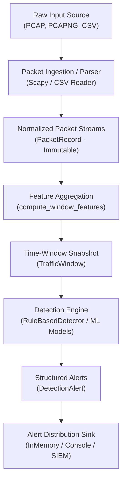
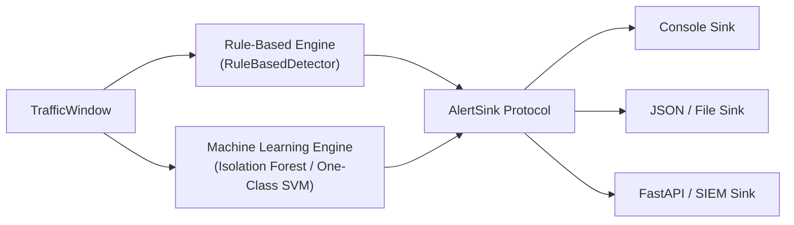

# DoS Attack Detector: Architecture Documentation

This document outlines the software architecture, data flow, design principles, and planned extension points for the **DoS Attack Detector** project.

---

## 1. System Overview & Core Philosophy

The primary objective of this project is to analyze network traffic offline and identify patterns indicative of Denial-of-Service (DoS) and Distributed Denial-of-Service (DDoS) attacks.

### Key Architectural Principles

1. **Defensive by Design**: The tool solely inspects traffic defensively. It does not generate attack traffic, probe remote networks, or execute defensive counter-attacks.
2. **Offline-First & Unprivileged**: Analysis runs on saved PCAP and CSV files. Parsing relies on pure file decoding rather than promiscuous network driver hooks (e.g., Npcap/WinPcap), requiring no root or administrator privileges.
3. **Decoupled Pipeline**: Raw ingestion (PCAP/CSV) is strictly separated from feature computation, detection heuristics, and alert reporting.
4. **Explainable Detections**: The engine does not emit opaque boolean alarms. It emits structured alerts containing observed metrics, applied rules, and confidence levels, acknowledging that legitimate traffic spikes can mimic attack patterns.
5. **Deterministic Immutability**: Core domain models (`PacketRecord`, `TrafficWindow`) are immutable value objects (`frozen=True`). This guarantees data integrity as records flow through multi-stage pipelines.

---

## 2. Pipeline Data Flow

The following diagram illustrates how raw network traces are transformed into defensive alerts:

---

## 3. Module Breakdown & Responsibilities

The codebase follows the modern Python `src` layout (`src/dos_detector/`):

### `models.py` (Domain Core)
- **`PacketRecord`**: Normalized representation of a single network packet (timestamp, IPs, protocol, ports, size, TCP flags). Shields the rest of the application from parser quirks.
- **`TrafficWindow`**: Aggregated metrics computed over a discrete time slice (e.g., 1.0 second). Tracks packet rates, byte rates, SYN/ACK distributions, and unique endpoints.
- **`Severity`**: Standardized enum (`INFO`, `LOW`, `MEDIUM`, `HIGH`, `CRITICAL`).
- **`DetectionAlert`**: Encapsulates a detected anomaly with metadata, confidence score, and supporting metrics snapshot.

### `config.py` (Configurable Parameters)
- Defines `DetectionConfig`.
- **Why this matters**: Hardcoded thresholds create brittle detection systems. A home network will flag 50 requests/second as an anomaly, whereas an enterprise web server regularly handles 10,000 requests/second. Externalizing thresholds enables adaptation without code modifications.

### `features.py` (Feature Engineering)
- Converts sequences of raw `PacketRecord` items into a single `TrafficWindow`.
- Calculates traffic rates (pps, bps) and key defensive ratios (such as `syn_ack_ratio`).

### `detector.py` (Detection Logic)
- Implements `BaseDetector` (Abstract Base Class).
- `RuleBasedDetector`: Evaluates deterministic heuristics against a `TrafficWindow`:
  - **SYN Flood**: Checks for elevated SYN packets per second without corresponding ACKs.
  - **Volumetric Flood**: Identifies bandwidth consumption exceeding configured byte thresholds.
  - **Packet Flood**: Identifies high-frequency packet generation that threatens CPU capacity.

### `alerting.py` (Output Abstraction)
- Defines `AlertSink` protocol.
- `InMemoryAlertSink`: Stores alerts for automated testing and batch verification.
- `ConsoleAlertSink`: Formats defensive summaries safely without printing raw packet payloads.

---

## 4. Planned Extension Points

The architecture is designed to accommodate planned enhancements without requiring rewrites:

1. **Sliding Time-Window Aggregations**: Sliding horizons (e.g., 1s, 5s, 60s) and Shannon entropy calculation for IP addresses to differentiate single-source DoS from distributed DDoS.
2. **Machine-Learning Anomaly Detection**: Implementing `MLDetector(BaseDetector)` utilizing scikit-learn models (such as `IsolationForest`) trained on normal baseline traffic.
3. **Web Dashboard & SIEM Export**: Connecting the `AlertSink` protocol to a lightweight FastAPI dashboard or JSON telemetry forwarder.
