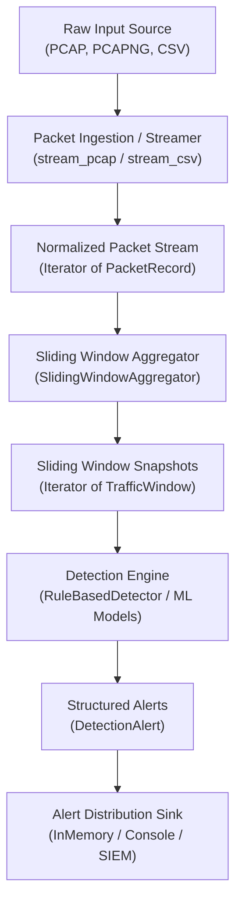
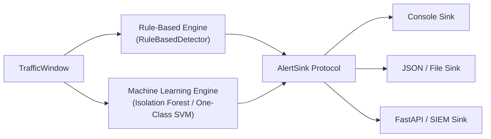

# DoS Attack Detector: Architecture Documentation

This document outlines the software architecture, data flow, design principles, and planned extension points for the **DoS Attack Detector** project.

---

## 1. System Overview & Core Philosophy

The primary objective of this project is to analyze network traffic offline and identify patterns indicative of Denial-of-Service (DoS) and Distributed Denial-of-Service (DDoS) attacks.

### Key Architectural Principles

1. **Defensive by Design**: The tool solely inspects traffic defensively. It does not generate attack traffic, probe remote networks, or execute defensive counter-attacks.
2. **Offline-First & Unprivileged**: Analysis runs on saved PCAP and CSV files. Parsing relies on pure file decoding rather than promiscuous network driver hooks (e.g., Npcap/WinPcap), requiring no root or administrator privileges.
3. **Decoupled Pipeline**: Raw ingestion (PCAP/CSV) is strictly separated from feature computation, detection heuristics, and alert reporting:
   `strumień pakietów ➔ SlidingWindowAggregator ➔ strumień okien ➔ Detektor ➔ AlertSink`
4. **Explainable Detections**: The engine does not emit opaque boolean alarms. It emits structured alerts containing observed metrics, applied rules, Shannon entropy distribution confidence, and explanatory notes.
5. **Deterministic Immutability**: Core domain models (`PacketRecord`, `TrafficWindow`) are immutable value objects (`frozen=True`). This guarantees data integrity as records flow through multi-stage pipelines.

---

## 2. Pipeline Data Flow

The following diagram illustrates how raw network traces are transformed into defensive alerts:

---

## 3. Module Breakdown & Responsibilities

The codebase follows the modern Python `src` layout (`src/dos_detector/`):

### `models.py` (Domain Core)
- **`PacketRecord`**: Normalized representation of a single network packet (timestamp, IPs, protocol, ports, size, TCP flags). Shields the rest of the application from parser quirks.
- **`TrafficWindow`**: Aggregated metrics computed over an observation window (packet rates, byte rates, SYN/ACK ratios, unique IPs, Shannon entropy, top source IP metrics).
- **`Severity`**: Standardized enum (`INFO`, `LOW`, `MEDIUM`, `HIGH`, `CRITICAL`).
- **`DetectionAlert`**: Encapsulates a detected anomaly with metadata, confidence score, attack type (`SINGLE_SOURCE_DOS`, `COORDINATED_DOS`, `DISTRIBUTED_DOS`), and supporting metrics snapshot.

### `config.py` (Configurable Parameters)
- Defines `DetectionConfig`. Externalizes threshold configuration (window size, SYN rates, volumetric bps thresholds).

### `features.py` (Feature Engineering & Windowing)
- **`SlidingWindowAggregator`**: FIFO queue (`deque`) generating overlapping sliding windows from an input packet stream with configurable `window_size` and `step_size`.
- **`stream_sliding_windows`**: Generator function connecting packet iterables to sliding windows.
- **`compute_shannon_entropy`**: Shannon entropy and normalized entropy (0.0 to 1.0) calculation on IP distributions.
- **`compute_window_features`**: Pure function calculating rates, flag distributions, and entropy metrics for a batch of records.

### `detector.py` (Detection Logic)
- Implements `BaseDetector` (Abstract Base Class).
- **`classify_attack_distribution`**: Classifies whether an anomaly is single-source DoS, coordinated DoS, or distributed DDoS using entropy and source ratios.
- **`RuleBasedDetector`**: Evaluates deterministic heuristics against a `TrafficWindow` (SYN flood, volumetric flood, packet flood).

### `alerting.py` (Output Abstraction)
- Defines `AlertSink` protocol.
- `InMemoryAlertSink`: Stores alerts for automated testing and batch verification.
- `ConsoleAlertSink`: Formats defensive summaries safely without printing raw packet payloads.

---

## 4. Planned Extension Points

The architecture is designed to accommodate planned enhancements without requiring rewrites:

1. **Machine-Learning Anomaly Detection**: Implementing `MLDetector(BaseDetector)` utilizing scikit-learn models (such as `IsolationForest`) trained on normal baseline traffic.
2. **Benchmark Evaluation**: Evaluating pipeline detection rates and false positives on the CIC-IDS2017 dataset.
3. **Web Dashboard & SIEM Export**: Connecting the `AlertSink` protocol to a lightweight FastAPI dashboard or JSON telemetry forwarder.
