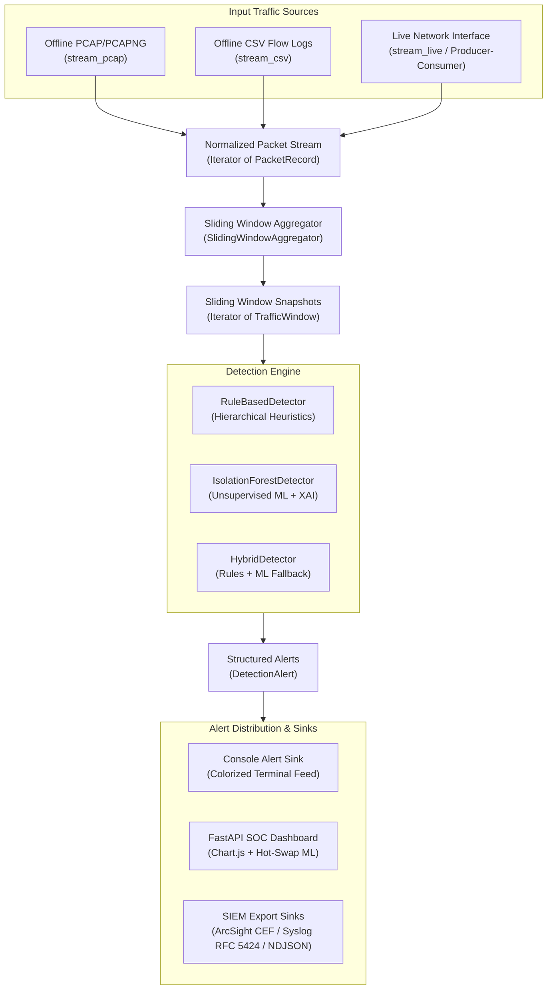

# DoS Attack Detector: Architecture Documentation

This document outlines the software architecture, data flow, design principles, and completed implementation milestones for the **DoS Attack Detector** project.

---

## 1. System Overview & Core Philosophy

The primary objective of this project is to analyze network traffic and identify patterns indicative of Denial-of-Service (DoS) and Distributed Denial-of-Service (DDoS) attacks across offline captures and live laboratory interfaces.

### Key Architectural Principles

1. **Defensive by Design**: The tool solely inspects traffic defensively. It does not generate attack traffic, probe remote networks, or execute offensive counter-attacks.
2. **Offline-First & Constant Memory**: Analysis runs on saved PCAP/CSV captures and live laboratory interfaces using streaming generators ($O(1)$ RAM footprint) without loading multi-gigabyte traces into memory.
3. **Decoupled Pipeline**: Raw ingestion (PCAP/CSV/Live) is strictly separated from feature computation, detection heuristics, machine learning, and alert distribution:
   `Packet Ingestion ➔ SlidingWindowAggregator ➔ Window Stream ➔ Detection Engine ➔ Alert & SIEM Sinks`
4. **Explainable Detections (XAI)**: The engine does not emit opaque boolean alarms. It emits structured alerts containing observed metrics, applied rules, Shannon entropy distribution confidence, and explainable feature divergence attribution ($Z$-score deviations).
5. **Deterministic Immutability**: Core domain models (`PacketRecord`, `TrafficWindow`, `DetectionAlert`, `NetworkInterfaceInfo`) are immutable value objects (`@dataclass(frozen=True, slots=True)`). This guarantees data integrity as records flow through multi-stage pipelines.

---

## 2. Pipeline Data Flow

The following diagram illustrates how raw network traffic from diverse sources is transformed into defensive alerts and enterprise security telemetry:

---

## 3. Module Breakdown & Responsibilities

The codebase follows the modern Python `src` layout (`src/dos_detector/`):

### `models.py` (Domain Core)
- **`PacketRecord`**: Normalized, immutable representation of a single network packet (timestamp, IPs, protocol, ports, size, TCP flags, Layer 7 HTTP metadata). Shields the rest of the application from parser quirks.
- **`TrafficWindow`**: Aggregated metrics computed over an observation window (packet rates, byte rates, SYN/ACK ratios, protocol breakdowns [TCP/UDP/ICMP/DNS], victim target concentration ratios, unique IPs, Shannon entropy, top source IP metrics).
- **`Severity`**: Standardized enum (`INFO`, `LOW`, `MEDIUM`, `HIGH`, `CRITICAL`).
- **`DetectionAlert`**: Encapsulates a detected anomaly with metadata, confidence score, attack type (`SINGLE_SOURCE_DOS`, `COORDINATED_DOS`, `DISTRIBUTED_DOS`), and supporting metrics snapshot.
- **`NetworkInterfaceInfo`**: Metadata describing discovered physical and logical network adapters (name, description, categorized type, IP addresses, MAC address, GUID).

### `config.py` (Configurable Parameters)
- Defines `DetectionConfig`. Externalizes threshold configuration:
  - `syn_flood_pps_threshold` & `syn_ack_ratio_threshold`,
  - `dns_amplification_pps_threshold`,
  - `http_flood_pps_threshold` & `http_uri_repetition_threshold`,
  - `udp_flood_pps_threshold` & `udp_ratio_threshold`,
  - `volumetric_bps_threshold` & `packet_flood_pps_threshold`,
  - Observation horizon (`window_size_seconds`, `min_consecutive_windows`, and `alert_cooldown_seconds`).

### `ingestion.py` (Traffic Streamers & Adapter Discovery)
- **`stream_pcap`**: Incremental generator reading PCAP/PCAPNG packets one-by-one via Scapy's `PcapReader` with constant memory footprint.
- **`stream_csv`**: Generator streaming tabular logs with support for generic CSV schemas and Canadian Institute for Cybersecurity (`CIC_IDS2017_CSV_MAPPING`).
- **`stream_live`**: Multi-threaded Producer-Consumer live packet streamer. A background worker thread captures raw packets via Scapy's `sniff(store=False)`, parses them into `PacketRecord` value objects, and buffers them in a bounded `queue.Queue(maxsize=10000)` to prevent memory exhaustion during flood surges. Supports Berkeley Packet Filters (`bpf_filter`) and external `threading.Event` termination.
- **`get_network_interfaces` & `resolve_interface_name`**: Cross-platform network interface discovery and categorization (Wi-Fi, Ethernet, Loopback, Virtual/VPN) decoupled from OS-specific registry modules for clean CI/CD execution.

### `features.py` (Feature Engineering & Windowing)
- **`SlidingWindowAggregator`**: FIFO queue (`deque`) generating overlapping sliding windows from an input packet stream with configurable `window_size` and `step_size`. Handles chronological fast-paths, out-of-order jitter with `bisect.insort`, and large time gap jump optimizations.
- **`compute_shannon_entropy`**: Calculates Shannon IP entropy ($H(X) = -\sum p(x)\log_2 p(x)$) and normalized entropy (0.0 to 1.0) on source IP distributions to differentiate single-source DoS from distributed botnets (DDoS).
- **`compute_window_features`**: Pure function calculating rates, flag distributions, protocol breakdowns, victim target concentration, and entropy metrics for a batch of records.

### `ml.py` (Machine Learning & Isolation Forest Anomaly Detection)
- **`FEATURE_NAMES` & `extract_window_features`**: Transforms an immutable `TrafficWindow` into a sanitized 10-dimensional numerical feature vector for tree-based anomaly isolation.
- **`train_isolation_forest`**: Unsupervised baseline profiling fitting scikit-learn's `IsolationForest` on legitimate benign traffic.
- **Model Persistence**: Safe artifact serialization and deserialization via `joblib`.
- **`get_default_baseline_model`**: Automatic cached baseline model providing out-of-the-box ML anomaly detection without requiring prior manual model training.

### `detector.py` (Detection Logic & Heuristics)
- Implements `BaseDetector` (Abstract Base Class).
- **`classify_attack_distribution`**: Classifies whether an anomaly is single-source DoS, coordinated DoS, distributed DDoS, or benign multi-target transit traffic by coupling Shannon entropy with victim target concentration.
- **`_is_benign_symmetric_burst` (Benign Burst Filter)**: Heuristic connection symmetry analysis that suppresses false alarms during fast, legitimate file downloads (e.g. CIC-DDoS-2019-Benign) by verifying TCP ACK/RST flow balance.
- **`RuleBasedDetector` (`base`)**: Evaluates deterministic heuristics against a `TrafficWindow` (DNS amplification/flood, UDP flood, TCP SYN flood, HTTP WebDDoS, volumetric flood, and packet flood) with sliding window persistence (`min_consecutive_windows`) and cooldown deduplication.
- **`IsolationForestDetector` (`ml`)**: Evaluates multidimensional feature divergences from the baseline, scoring anomalies and explaining which metrics triggered the alert (`_explain_anomalous_features`).
- **`HybridDetector` (`hybrid`)**: Ensemble engine combining high-precision rule heuristics with an unsupervised Isolation Forest fallback for low-rate and novel anomalies.

### `alerting.py` (Output Abstraction)
- Defines `AlertSink` protocol.
- `InMemoryAlertSink`: Stores alerts for automated testing and batch verification.
- `ConsoleAlertSink`: Formats defensive summaries safely without printing raw packet payloads.

### `siem.py` (Enterprise SIEM Integration)
- **`format_alert_cef`**: Formats alerts into Micro Focus ArcSight Common Event Format (`CEF:0|Vendor|Product|Version|SignatureID|Name|Severity|Extension`) with 0-10 severity scaling, header escaping, and extensions (`src=`, `dst=`, `cs1=`, `cs2=`, `cfp1=`, `rt=`).
- **`format_alert_syslog_rfc5424`**: Formats alerts according to RFC 5424 with priority calculation (`<PRI>1`), UTC ISO 8601 timestamp, and Structured Data (`[dosAlert@5424 ...]`).
- **`format_alert_json`**: Serializes alerts into single-line NDJSON (for Splunk HEC and ElasticSearch) or pretty-printed JSON documents.
- **`SiemAlertSink` & `export_alerts_to_file`**: Output sinks supporting streaming to files, `sys.stdout`, or network pipelines.

### `evaluation.py` (Benchmark & Dataset Evaluation Harness)
- **`GroundTruthInterval` & `AttackSchedule`**: Model external attack schedules and time intervals for raw captures (e.g., CIC-IDS2017 PCAP files).
- **`EvaluationMetrics`**: Computes standard cybersecurity detection metrics: True Positives (TP), False Positives (FP), True Negatives (TN), False Negatives (FN), Precision, Recall, Specificity, False Positive Rate (FPR), Accuracy, and F1-Score.
- **`DatasetEvaluator`**: End-to-end evaluation runner streaming labeled CSV flows or PCAPs, tracking confusion matrices, per-attack recall breakdown, and JSON export.
- **`generate_synthetic_benchmark_stream`**: Deterministic multi-phase benchmark generator (Benign baseline + SYN flood + HTTP WebDDoS + UDP flood) for testing and educational validation without multi-gigabyte downloads.

### `server.py` (FastAPI Monitoring Backend & SOC Dashboard)
- **REST API Endpoints**:
  - `GET /`: Serves the embedded HTML5/CSS/JavaScript SOC dashboard.
  - `GET /api/health`: Provides detector health, active detection mode, telemetry counters, and version info.
  - `GET /api/config` & `POST /api/config`: Dynamic runtime inspection and reconfiguration of detection thresholds and detector modes (`hybrid`, `base`, `ml`).
  - `POST /api/model/upload` & `POST /api/model/reset`: Allows uploading custom serialized `.joblib` Isolation Forest models and dynamically hot-swapping the active engine, or resetting to the built-in reference baseline.
  - `POST /api/analyze/demo`: Evaluates synthetic multi-phase educational traffic and returns timeline series data with triggered alert tags.
  - `POST /api/analyze/upload`: Safely ingests uploaded offline capture files (`.pcap`, `.pcapng`, `.csv`), buffers them into temporary files, evaluates windows, and unlinks files immediately upon completion.
  - `GET /api/alerts` & `POST /api/alerts/clear`: Fetches historical alerts and resets state.
  - `GET /api/alerts/export`: Directly downloads filtered alert telemetry formatted for SIEM ingest (`format=cef|syslog|json|ndjson`).
- **Embedded SOC Dashboard**:
  - Responsive dark-theme dashboard designed for SOC/CERT analysts.
  - Interactive Chart.js timeline showing packet rates (PPS), bandwidth (BPS), and shaded anomaly zones.
  - Drag-and-drop offline capture file upload with format validation.
  - Real-time alert feed displaying attack classification (Single-source DoS vs DDoS), severity tags, and explainable AI feature contribution badges.
  - 1-Click SIEM export buttons (`[📥 CEF]`, `[📥 Syslog]`, `[📥 NDJSON]`).

---

## 4. Completed Implementation Roadmap

All planned phases of the DoS Attack Detector have been fully implemented, validated, and documented:

| Phase | Milestone Description | Implementation Status | Key Modules |
| :--- | :--- | :--- | :--- |
| **Stage 1** | Rule-based detection using configurable thresholds | **Completed** | `config.py`, `detector.py`, `models.py` |
| **Stage 2** | Offline traffic analysis using CSV and PCAP files | **Completed** | `ingestion.py`, `cli.py` |
| **Stage 3** | Network feature extraction and time-window aggregation | **Completed** | `features.py`, `models.py` |
| **Stage 4** | Quantitative evaluation against labeled datasets (CIC-IDS2017) | **Completed** | `evaluation.py`, `cli.py` |
| **Stage 5** | Machine-learning-based anomaly detection (Isolation Forest) | **Completed** | `ml.py`, `detector.py` |
| **Stage 6** | FastAPI backend and interactive SOC monitoring dashboard | **Completed** | `server.py`, `cli.py` |
| **Stage 7** | Live traffic monitoring in authorized lab environments | **Completed** | `ingestion.py`, `cli.py` |
| **Stage 8** | Enterprise SIEM Integration (ArcSight CEF, Syslog RFC 5424, NDJSON) | **Completed** | `siem.py`, `cli.py`, `server.py` |
